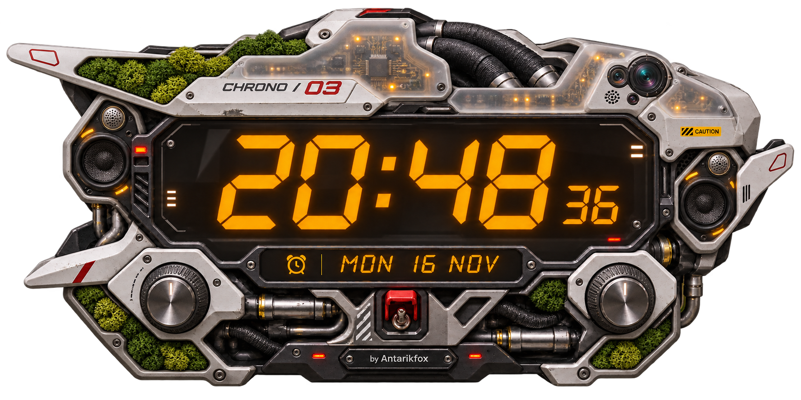

<div align="center">

# CHRONO / 03 BIO

### A little mecha. A little nature. Always on time.

**Home Assistant dashboard clock · by Antarikfox**


[English](README.md) · [Русский](README.ru.md) · [Live preview](docs/preview.html)



</div>

A custom clock card with white mecha armor, warm amber digits and pockets of preserved moss. Frosted panels reveal circuit boards; speakers, lenses and a guarded toggle complete the instrument.

The time and date are live. The case illustration is static. The digits use a purpose-built SVG segment grid with consistent thickness, clean gaps and a shared rightward slant, so they stay crisp at different dashboard sizes.

## Features

- Hours, minutes and optional seconds; configurable IANA time zone.
- English and Russian interface, including the visual card editor.
- Automatic language selection from your Home Assistant profile.
- Date locale can be set separately from the interface language.
- Brightness controls and manual or scheduled night dimming.
- Entity dropdown for the red toggle; optional dashboard navigation.
- Transparent outside silhouette; artwork embedded in a single JavaScript file.
- No external fonts, CDNs, runtime dependencies or network requests by the card.

## Install through HACS

Until this repository is included in the default catalog, add it as a **custom repository**:

1. In HACS, open **⋮ → Custom repositories**.
2. Paste this repository's GitHub URL and choose **Dashboard** (called **Lovelace** in some versions).
3. Find **CHRONO / 03 BIO Clock — by Antarikfox**, download it and refresh your browser.
4. If HACS has not registered the resource, add it manually as a **JavaScript module**:

   ```text
   /hacsfiles/antarikfox-chrono-bio-clock/antarikfox-chrono-bio-clock.js
   ```

5. Add a **Manual** card with the configuration below. Do not register both the HACS and manual-install resources at the same time.

## Manual installation

Download `antarikfox-chrono-bio-clock.js` from the release or `dist/` directory. Copy it to `/config/www/`, then add this **JavaScript module** resource:

```text
/local/antarikfox-chrono-bio-clock.js?v=1.2.0
```

If you have just created the `www` directory, restart Home Assistant. Refresh the dashboard after adding the resource. If your downloaded file ends in `.js.txt`, remove only `.txt`.

## Add the card

```yaml
type: custom:antarikfox-chrono-bio-clock
timezone: Europe/Moscow
language: auto
show_seconds: true
auto_night: true
night_start: 23
night_end: 7
```

Open the visual editor to change these settings and select the entity for the red toggle.

| Option | Default | Description |
|---|---|---|
| `timezone` | `Europe/Moscow` | IANA time zone, for example `Europe/London` or `America/New_York`. |
| `language` | `auto` | `auto`, `en` or `ru`. Automatic mode follows HA's interface language; other languages fall back to English. |
| `locale` | Based on language | Optional date locale, for example `en-GB` or `ru-RU`. |
| `show_seconds` | `true` | Show the smaller seconds display. |
| `auto_night` | `false` | Dim live displays during the configured interval. |
| `night_start` | `23` | Start hour, integer from 0 to 23, inclusive. |
| `night_end` | `7` | End hour, integer from 0 to 23, exclusive. Equal start/end disables the scheduled interval. |
| `alarm_entity` | Unset | Open this entity's native HA more-info dialog using the red toggle. No service is called. |
| `navigation_path` | Unset | Same-site path opened by the lower-right red LED, for example `/lovelace/0`. |

## Physical-style controls

| Control | Action |
|---|---|
| Left rotary knob | Decrease live-display brightness. |
| Right rotary knob | Increase live-display brightness. |
| Red guarded toggle | Toggle manual night mode, or open `alarm_entity` if configured. |
| Red LED immediately left of the time screen | Open brightness and night-mode settings. |
| Lower-right red LED near the signature plaque | Navigate to `navigation_path`, if configured. |

Manual brightness and manual night mode reset when the page reloads. The automatic schedule remains in the card configuration. Manual night mode and scheduled night mode are combined: either can keep the displays dimmed. Dimming affects the live displays; the illustration's decorative LEDs remain part of the artwork.

The clock uses the viewing device's system time, converted to the configured time zone. Keep that device's clock synchronized. The card does not create an alarm or play audio. The illustrated speakers and optics do not access a camera or microphone.

## Preview and development

Download `docs/preview.html` and open it in a browser. It is self-contained and includes an English/Russian switch. GitHub displays HTML source rather than running this preview inline.

No dependencies need to be installed for the build or unit checks. With Node.js 22 or newer:

```bash
npm run check
npm run build
```

The source template and original artwork live in `src/`. The build embeds the artwork in `dist/antarikfox-chrono-bio-clock.js` and regenerates the standalone preview. Commit the built files together with source changes.

Validation covers local-time/date rollover, overnight dimming, language selection, brightness bounds, seconds visibility, configuration validation, SVG geometry and timer cleanup. The digit geometry was also inspected with an SVG render. Live Home Assistant installation testing is still pending.

## Troubleshooting

| Symptom | Check |
|---|---|
| Custom element does not exist | Check the resource path, module type and browser cache; register only one copy. |
| Old appearance after update | Refresh the page and change the manual resource version query. |
| Wrong time | Check the viewing device's clock and `timezone`. |
| Text or controls too small | Give the card more columns or a full-width section. |
| Date language differs from UI | Check `locale`; it deliberately overrides the date language. |

## License and credits

MIT. Code and artwork package by **Antarikfox**. Artwork created with AI assistance; live digit geometry and card behavior are implemented in code. This is an independent community project, not an official Home Assistant product.