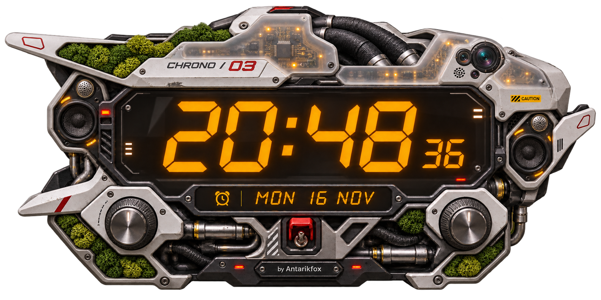

<div align="center">

# CHRONO / 03 BIO

### Немного меха. Немного природы. Точное время.

**Часы для панели Home Assistant · by Antarikfox**


[English](README.md) · [Русский](README.ru.md) · [Живой предпросмотр](docs/preview.html)



</div>

Белая броня, янтарные цифры, электроника за матовыми панелями и карманы со стабилизированным мхом. Динамики, оптика и красный тумблер дополняют вид приборного модуля.

Время и дата обновляются программно. Корпус — статичная иллюстрация. Цифры построены из SVG-сегментов с одинаковой толщиной, ровными зазорами и единым наклоном вправо.

## Возможности

- Часы, минуты и отключаемые секунды; выбор часового пояса.
- Русский и английский интерфейс, включая визуальный редактор карточки.
- Автоматический выбор языка по профилю Home Assistant.
- Отдельная настройка языка даты.
- Яркость, ручной ночной режим и затемнение по расписанию.
- Выпадающий список сущностей для тумблера и переход на другую панель.
- Прозрачный фон вокруг корпуса; вся графика внутри одного JS-файла.
- Без внешних шрифтов, CDN, дополнительных библиотек и сетевых запросов карточки.

## Установка через HACS

До включения в общий каталог добавь репозиторий вручную:

1. Открой **HACS → ⋮ → Пользовательские репозитории**.
2. Вставь GitHub-адрес этого репозитория и выбери тип **Панель управления / Dashboard** (в некоторых версиях — **Lovelace**).
3. Найди **CHRONO / 03 BIO Clock — by Antarikfox**, скачай и обнови страницу.
4. Если HACS не добавил ресурс автоматически, добавь его как **JavaScript-модуль**:

   ```text
   /hacsfiles/antarikfox-chrono-bio-clock/antarikfox-chrono-bio-clock.js
   ```

5. Добавь карточку **«Вручную»** с конфигурацией ниже. Регистрировать одновременно HACS-версию и ручную копию не нужно.

## Ручная установка

Скачай `antarikfox-chrono-bio-clock.js` из релиза или папки `dist/`. Положи файл в `/config/www/` и добавь ресурс типа **JavaScript-модуль**:

```text
/local/antarikfox-chrono-bio-clock.js?v=1.2.0
```

Если папка `www` создана впервые, перезапусти Home Assistant. Затем обнови страницу панели. Если файл скачался с окончанием `.js.txt`, убери только `.txt`.

## Добавление карточки

```yaml
type: custom:antarikfox-chrono-bio-clock
timezone: Europe/Moscow
language: auto
show_seconds: true
auto_night: true
night_start: 23
night_end: 7
```

В визуальном редакторе можно изменить настройки и выбрать сущность для красного тумблера из списка.

| Параметр | По умолчанию | Назначение |
|---|---|---|
| `timezone` | `Europe/Moscow` | Часовой пояс IANA, например `Europe/London`. |
| `language` | `auto` | `auto`, `ru` или `en`. Автоматический режим следует языку HA; для других языков используется английский. |
| `locale` | По языку интерфейса | Отдельный язык даты, например `ru-RU` или `en-GB`. |
| `show_seconds` | `true` | Показывать маленькие цифры секунд. |
| `auto_night` | `false` | Затемнять дисплеи по расписанию. |
| `night_start` | `23` | Час начала, целое число 0–23; начало включается в интервал. |
| `night_end` | `7` | Час окончания, целое число 0–23; окончание не включается. При одинаковых значениях расписание отключено. |
| `alarm_entity` | Не задан | Сущность, стандартное окно которой открывает тумблер. Команды управления не отправляются. |
| `navigation_path` | Не задан | Путь внутри HA для нижнего правого LED, например `/lovelace/0`. |

## Управление

| Элемент | Действие |
|---|---|
| Левая ручка | Уменьшить яркость живых дисплеев. |
| Правая ручка | Увеличить яркость живых дисплеев. |
| Красный тумблер | Ручной ночной режим или окно `alarm_entity`, если сущность выбрана. |
| Красный LED слева от основного экрана | Открыть настройки яркости и ночного режима. |
| Нижний правый красный LED рядом с подписью | Перейти по `navigation_path`, если путь задан. |

Ручные яркость и ночной режим сбрасываются после обновления страницы. Автоматическое расписание сохраняется в конфигурации. Ручной и автоматический ночные режимы складываются: пока активен хотя бы один, дисплеи затемнены. Декоративные огни корпуса остаются частью иллюстрации.

Время берётся с устройства, на котором открыта панель, и переводится в выбранный часовой пояс. Часы устройства должны быть синхронизированы. Карточка не создаёт будильник и не воспроизводит звук. Нарисованные динамики и оптика не получают доступ к камере или микрофону.

## Предпросмотр и разработка

Скачай `docs/preview.html` и открой в браузере. Внутри есть переключатель русского и английского. На GitHub HTML отображается как исходный код — для работы его нужно скачать.

С Node.js 22 или новее, без установки дополнительных библиотек:

```bash
npm run check
npm run build
```

Исходный шаблон и графика находятся в `src/`. Сборка создаёт `dist/antarikfox-chrono-bio-clock.js` и самостоятельный HTML-предпросмотр. После изменения исходников нужно сохранить в коммите и результаты сборки.

Проверены смена даты через полночь, ночное расписание, выбор языка, пределы яркости, секунды, проверка конфигурации, геометрия SVG и остановка таймера. Геометрия цифр также проверена отдельным SVG-рендером. Проверка установки на живом Home Assistant пока не выполнена.

## Если что-то не работает

| Симптом | Что проверить |
|---|---|
| Custom element does not exist | Адрес ресурса, тип «JavaScript-модуль», кэш браузера и отсутствие второй копии ресурса. |
| После обновления старый вид | Обновить страницу; при ручной установке поменять версию в адресе ресурса. |
| Неправильное время | Часы устройства и параметр `timezone`. |
| Мелкие цифры или кнопки | Выделить карточке больше столбцов или всю ширину секции. |
| Язык даты отличается | Проверить `locale`: он специально переопределяет язык даты. |

## Авторство и лицензия

MIT. Код и графический комплект — **Antarikfox**. Иллюстрация создана с помощью ИИ; живые цифры и поведение карточки реализованы программно. Это независимый проект сообщества, не официальный продукт Home Assistant.